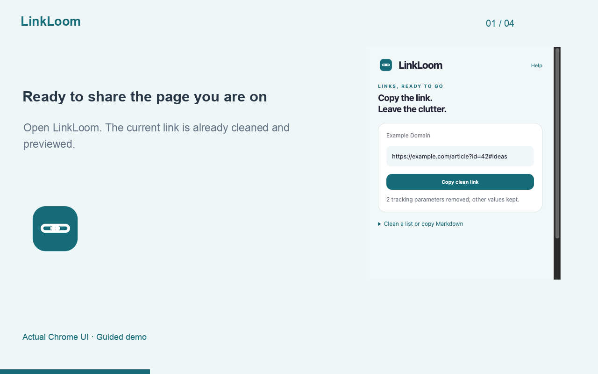

# LinkLoom

Open. Copy. Share a cleaner link.

The page you are on is already ready to share. Open LinkLoom, review the cleaned URL, and click Copy clean link. No paste step or setup required.

## See it work

[Video and steps](store/demo/README.md). Fictional demo data; FocusPet completion is accelerated and disclosed.

## Features

- Preview the active page URL immediately when opening the extension.
- Copy a clean link only when you click the button.
- Remove recognized trackers while keeping functional values and fragments.
- Preserve detected signed or tokenized links unchanged.
- Optional batch cleanup of up to 100 links, Markdown and text export.

## Limits

LinkLoom does not visit destinations, expand short URLs, or guarantee that all tracking is removed. It preserves unrelated query values and fragments. Invalid links are excluded from copy/export results. Links with embedded credentials are rejected. Always review important links before sharing.

## Development

Load `extension/` unpacked in Chrome Developer mode. Run `npm test` and `npm run package`. There is no runtime dependency or build step.

## Privacy

URLs are held in popup memory only and are not persistently stored. Links are placed on the clipboard or in a downloaded text file only at your request.

`activeTab` reads the current tab URL and title when you open the extension, to prepare the preview. No page content is read. Clipboard writing happens only on a copy button click.

See [PRIVACY.md](PRIVACY.md). No accounts, ads or analytics.

## Product evidence

[Market analysis and validation plan](docs/market-analysis.md). Adoption remains unvalidated.

## Support and license

Use the repository issue tracker; remove private information. MIT.
